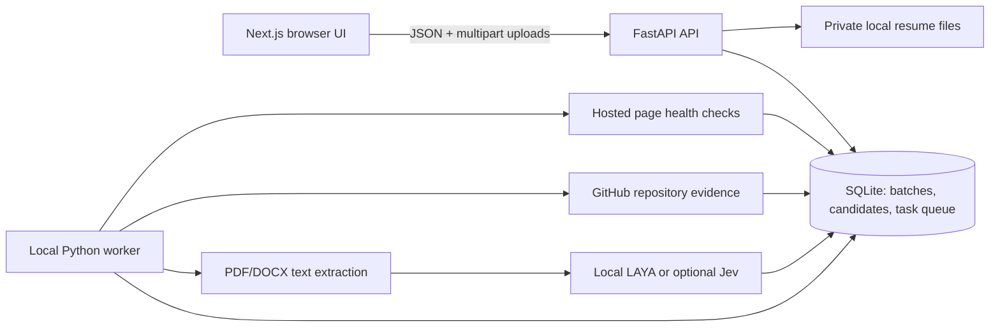

# Resume Screening

A student project for reviewing a batch of resumes against one job. HR provides the job title and job description; the screening model infers core requirements, the requested technology stack, and comparable or transferable experience. The app advances a configurable share, then checks the advanced candidates' public projects and hosted pages.

## System design



There are three simple local processes: Next.js, FastAPI, and one Python worker. SQLite is both the database and the persistent queue. Each queued row has a stage, retry count, and lease; the worker claims a task in a short transaction, performs the slow work outside the transaction, then saves the result. This avoids losing tasks on restart and lets the web request return quickly. RabbitMQ would add another service to install and explain; it is useful when multiple machines need to share a high-volume queue, which this local student project does not currently require.

## Run locally

Use Python 3.10+ and Node.js 20.9+.

1. Install Python dependencies:

   ```bash
   python -m venv .venv
   source .venv/bin/activate
   pip install -r requirements.txt
   cp .env.example .env
   ```

   On Windows, activate `.venv\\Scripts\\activate`.

2. Install the frontend packages once:

   ```bash
   cd frontend
   npm install
   cp .env.example .env.local
   ```

3. Start FastAPI from the project root in one terminal:

   ```bash
   .venv/bin/uvicorn app.main:app --reload --host 127.0.0.1 --port 8000
   ```

4. Start the worker from the project root in another terminal:

   ```bash
   .venv/bin/python -m app.worker
   ```

5. Start Next.js from `frontend/` in a third terminal:

   ```bash
   npm run dev
   ```

6. Open <http://localhost:3000>.

The first LAYA run downloads model weights from Hugging Face. It uses local CPU/GPU memory; it does not have a per-token API fee. The default worker concurrency is one because the model is large.

To switch stage one back to Jev, set `SCREENING_PROVIDER=jev` and add `TYPESAFE_API_KEY` in the root `.env`, then restart the worker.

## Screening and flexibility

The form only asks for the job title, job description, shortlist settings, and resumes. Resumes can be added in multiple selections before submitting. The model reads the full job description and resume to estimate core requirement evidence, exact technology-stack fit, and comparable/transferable experience. Candidates with core-requirement evidence are eligible; exact stack matches rank first, then comparable experience, then other eligible candidates. The configured share (30% by default) advances. The final shortlist is calculated from the actual number that advanced (10% by default, rounded up to at least one when the group is non-empty). The model does not receive a manually classified checklist; its inferences need human review.

LAYA's probabilities are experimental. A small fictional smoke comparison ranked a weaker example above a stronger Python/SQL example. Review every result; do not use the model output as an automatic hiring decision. Its probabilities are judgments about evidence in the submitted text, not job-success probabilities.

## Project evidence and site checks

Only candidates selected after stage one enter project review. The extractor accepts explicit GitHub repository links and project demo links; it ignores GitHub profile links, general contact links, and coding profiles such as LeetCode and Codeforces. Stage two checks only the exact repositories linked in the resume. It never searches a candidate's GitHub profile for other repositories. It checks a linked repository's README, common dependency manifests, repository language, and up to four source files. Common hosted-demo links are checked for availability. Hidden PDF links are accepted as demos only when they use a recognized app-hosting domain because their visible link label cannot be reliably recovered. Related repository and demo links are grouped under one project.

The report shows how the resume link was associated with each inspected source, compares the nearby project description with public material when the text association is clear, and checks claimed technologies against source code, dependency files, and the README. A possible mismatch or unclear association is a review flag, not proof the candidate lied. Project evidence changes the score only when the public source can be tied to the project claim.

The report also compares distinctive words from the resume's project description near the link with the public README, manifests, source sample, or hosted page. It shows matching excerpts as a review aid. This is a keyword comparison; it cannot prove that a feature works or that the candidate personally wrote every line.

For a hosted link, it follows a limited number of public redirects and checks the HTTP response, page title, visible text, and up to two linked JavaScript/CSS assets. This catches a down host, an error page, an empty page shell, or missing static assets. It does not execute app interactions, log in, exercise forms, or prove the features work end to end. That limitation is shown in the candidate report.

Stage two can add 2 points per distinct role criterion found in the public project text and 1 point per distinct technology claim corroborated in source, manifests, or the README, capped at +10. GitHub profile URLs and unclear project associations do not affect the score. A missing public link is not evidence of a false resume claim.

## Queue and storage

The queue is the `tasks` table in `data/screening.db`, not RabbitMQ. It supports resumable local processing and retry/backoff for transient API or GitHub rate-limit errors. When GitHub's anonymous API quota is exhausted, Stage 2 waits for its reset and shows that status. A free GitHub personal access token can be added as `GITHUB_TOKEN` in the root `.env` to avoid the low anonymous quota. This queue is a good fit for one local worker and a student demo; one computer's CPU/GPU, disk, and GitHub API quota determine how fast a large batch finishes.

Original resumes stay in `data/uploads/` while stage one needs them and are deleted after screening completes. Extracted full resume text is not stored in SQLite. The database does keep scores, selected excerpts, project evidence, filenames, and task status. LAYA runs locally after downloading weights. Jev sends extracted resume text to TypeSafe. Project inspection makes public requests to GitHub and candidate-linked websites.

## Main files

- `frontend/src/app/` — Next.js upload, batch dashboard, and candidate report screens.
- `app/main.py` — FastAPI upload/API endpoints.
- `app/db.py` — SQLite records, task queue, and shortlist transitions.
- `app/worker.py` — background resume and project processing.
- `app/resume.py` — PDF/DOCX extraction and project-link context.
- `app/laya_screening.py` — local LAYA questions and probability handling.
- `app/evidence.py` — GitHub repository, README, manifest, and hosted-site checks.
- `app/jev.py` — optional TypeSafe Jev provider.

## Limits

- Scanned/image-only PDFs need OCR, which is not included.
- Website checks are bounded health checks, not browser-based functional testing.
- Repository and website evidence is incomplete. “Not verified” should lead to human review, not an accusation.
- The local app has no user accounts and should not be exposed to the public internet.
- Stage-one model results need validation on a labeled resume set before the rankings can be trusted.
