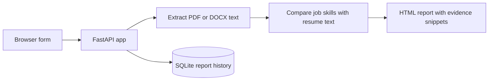

# Resume Screening

A small student project that helps someone make a first, explainable comparison between a resume and a job description. It extracts text from a PDF or DOCX, checks for listed skills, and shows short resume excerpts where a keyword was found.

This is deliberately a **single local Python application**. It uses FastAPI for the form and report pages, SQLite for a small report history, and local temporary file storage. There is no Docker, Redis, cloud service, AI key, or background worker to configure.

## Run it

Use Python 3.10 or newer.

```bash
python -m venv .venv
source .venv/bin/activate
pip install -r requirements.txt
uvicorn app.main:app --reload
```

On Windows, activate the environment with `.venv\\Scripts\\activate`. Open <http://127.0.0.1:8000> in a browser.

The first run creates a `data/` folder for the SQLite database and temporary uploads. Uploaded resume files are deleted after extraction. The saved report keeps the filename and matched text snippets, not the full resume text. Delete `data/screening.db` to clear local report history.

## How to use it

1. Enter a job title and paste its description.
2. Optionally enter the skills you want to compare, separated by commas. This gives the clearest result.
3. Upload one PDF or DOCX resume (up to 10 MB).
4. Review the keyword coverage, matched terms with excerpts, and terms not found.

If the skills box is empty, the app looks for common technical and workplace skills in the job description. Scanned PDFs and password-protected PDFs are not supported yet.

## Simple architecture



- `app/main.py` handles the form, upload, and report pages.
- `app/screening.py` extracts text and compares the requirements using simple word and phrase matching.
- `app/database.py` stores the small report history in SQLite.
- `templates/` and `static/` contain the browser pages and styling.

## How the score works

`Keyword coverage = matched listed skills / total listed skills × 100`. A match means the term or one of a small set of common aliases appears in the extracted resume text. Each match includes a nearby excerpt so a person can review the context.

This is not an AI assessment, a measure of someone's ability, or a probability of employment success. A keyword that was not found may be described differently in the resume, and PDF extraction can miss content. Review the original resume before making a decision.

## Current limits

- One resume per analysis; no bulk screening.
- Exact keyword and alias matching only; no semantic understanding.
- Scanned/image-only PDFs need OCR, which is not included.
- No external profile or project research.
- Runs on the same computer as the user; it is a learning project, not a production hiring system.
# resume-screening
