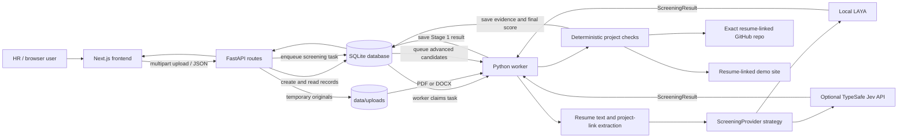
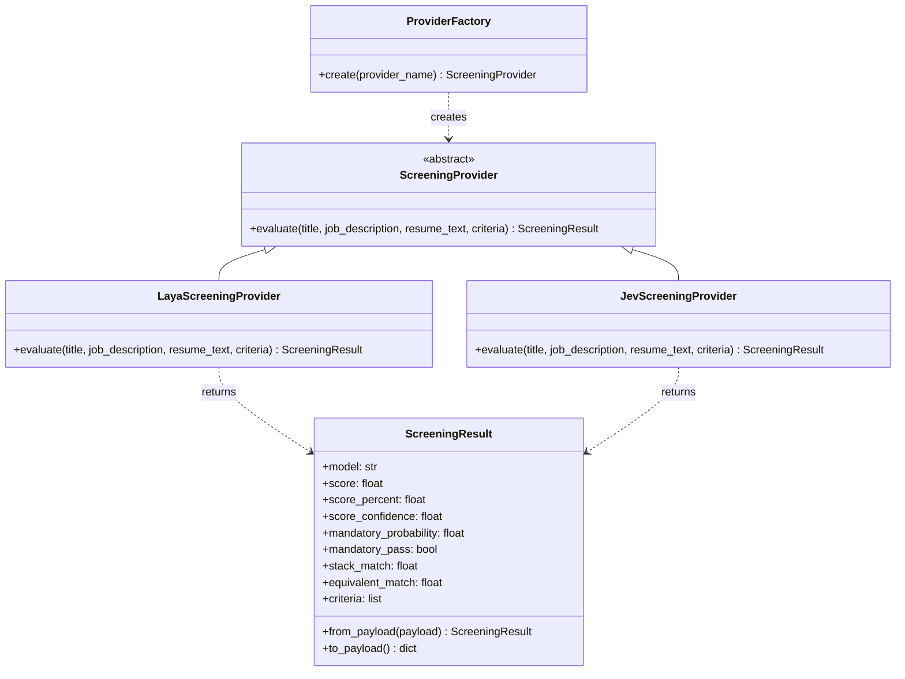
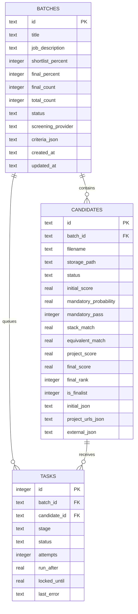
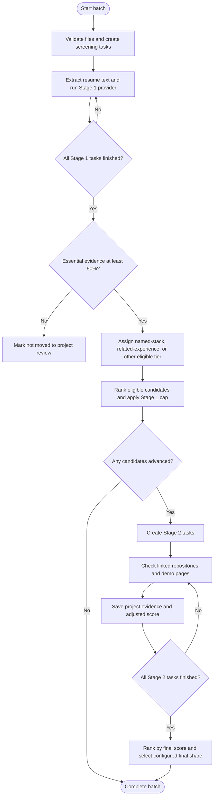

# Shortlist — Resume Screening System

Shortlist helps a hiring team review resumes against one job description. It has two review stages: an AI-assisted resume comparison, followed by public project-evidence checks for candidates who advance. The application organizes evidence; a human makes the hiring decision.

This README documents the implemented design and the UML diagrams you can use to explain it. It calls out where the code uses object-oriented design and where it remains intentionally module/function based. It does not claim every possible LLD pattern or principle is implemented.

## 1. Requirements and use cases

### Actors

| Actor | Role |
| --- | --- |
| HR / hiring reviewer | Creates a batch, uploads resumes, checks progress, reviews candidate reports, and exports results. |
| Background worker | Processes screening and project-check tasks outside the web request. |
| Stage 1 provider | Local LAYA model or optional TypeSafe Jev API. |
| Public project services | GitHub API and candidate-linked demo websites read during Stage 2. |

### Functional requirements

1. HR can create a batch from a job title, job description, shortlist settings, consent, and multiple PDF/DOCX resumes.
2. The API validates and stores usable uploads, creates candidate records, and queues Stage 1 work.
3. The worker extracts resume text and gets a normalized Stage 1 result from the selected provider.
4. Eligible candidates are selected for Stage 2 using the essential-requirements gate and technology-evidence ranking.
5. The worker checks only project repositories and demos associated with the links in advanced candidates’ resumes.
6. HR can see batch progress, candidate reports, shortlist results, and download a CSV.

### Non-functional requirements and current limits

- Run locally with a small number of understandable processes; no Docker or message broker is required.
- Keep slow model and network work out of HTTP requests.
- Preserve queued tasks across process restarts and prevent concurrent workers claiming the same task.
- Validate files and show failures in candidate status.
- Keep original resume files temporarily; delete each after Stage 1. Do not store full extracted resume text in SQLite.
- Scores are review guidance, not hiring decisions. The local API has no user authentication and must not be exposed publicly.
- Limits are 3,000 files per batch, 15 MB per file, and 3 GB total. Local hardware and API quota affect throughput.

These requirements describe the behavior implemented in the app; they are not a separate formal requirements document.

## 2. Architecture

This is a modular, single-machine system. Next.js, FastAPI, and the Python worker are separate local processes. They share SQLite and the local upload directory.



### Main responsibilities

| Component | Responsibility |
| --- | --- |
| `frontend/src/app/` | Homepage, upload dashboard, batch progress, and candidate evidence report. |
| `app/main.py` | FastAPI endpoints, upload validation, and HTTP responses. |
| `app/db.py` | SQLite schema, reads/writes, persistent queue, task claiming, and shortlist transitions. |
| `app/worker.py` | Claims tasks, orchestrates extraction, Stage 1, Stage 2, and error handling. |
| `app/resume.py` | Extracts PDF/DOCX text and identifies project-related links. |
| `app/screening.py` | Provider interface, concrete strategies, normalized result DTO, and provider factory. |
| `app/laya_screening.py`, `app/jev.py` | Provider-specific model/API calls and response interpretation. |
| `app/evidence.py` | Bounded GitHub repository and public website evidence checks. |

The API and worker are separate processes, but this is not a distributed microservice deployment. The queue is the `tasks` table in SQLite; there is no RabbitMQ service.

## 3. Object-oriented design and class diagram

The provider boundary is where this project uses an explicit object-oriented design. It uses the Strategy pattern: the worker calls the same interface while the selected provider supplies the implementation. `ScreeningResult` is a data-transfer object that gives both providers the same result shape.



The persisted entities are database rows, not Python domain classes. Their actual schema is shown separately in the ER diagram below. The implementation does not claim a class hierarchy for `Batch`, `Candidate`, or `Task`.

### Principles and patterns actually used

- **Abstraction:** `ScreeningProvider.evaluate(...)` hides the provider-specific call and gives the worker one interface.
- **Encapsulation:** each provider adapter owns the call to its underlying implementation; `ScreeningResult` owns the stable result fields and conversion to a persistence payload.
- **Inheritance and polymorphism:** LAYA and Jev provider classes implement the abstract base class. The worker receives the base type and invokes `evaluate()` without branching on provider type.
- **Single Responsibility Principle (module level):** API routes, database operations, resume extraction, provider integrations, and project checking are in separate modules. The provider adapters each have one integration responsibility.
- **Dependency Inversion:** `_process()` in `app/worker.py` depends on `ScreeningProvider`, not directly on LAYA or Jev. The provider is supplied when the worker starts.
- **Open/Closed (at the worker boundary):** another provider can implement `ScreeningProvider` without changing the worker loop. It must also be registered in `ProviderFactory`.
- **Liskov Substitution:** both provider implementations return the same `ScreeningResult` contract, so either can be supplied to the worker.
- **Interface Segregation:** the provider interface has one focused operation, `evaluate()`.
- **Strategy pattern:** LAYA and Jev are interchangeable screening algorithms selected for the run.
- **Factory pattern:** `ProviderFactory.create()` centralizes provider construction from configuration.
- **Producer–consumer pattern:** the API produces task rows; the worker consumes them. This is the queue behavior, not a separate broker library.
- **Singleton-like model reuse:** the local LAYA router is lazily initialized and reused behind a lock in `app/laya_screening.py`. It is not a formal Singleton class.

The API is not a strict controller/service/repository stack: routes call database functions from `app/db.py`. The project does not currently use a separate repository interface, event Observer, Builder, or Decorator pattern. These omissions are deliberate scope limits; do not claim they exist.

## 4. Database schema and relationships

The runtime database file is `data/screening.db`. Its schema is declared in `app/db.py`, in `initialize()`. SQLite uses foreign-key enforcement, WAL mode, and indexes for queue lookup and candidate listing.



Relationship details:

- One batch has many candidate rows and many task rows.
- Each usable candidate gets a Stage 1 task. A candidate selected for Stage 2 gets one additional task.
- `candidates.batch_id` references `batches.id`; task rows reference their batch and candidate. Deleting a batch cascades to its records.
- `UNIQUE(batch_id, stage, candidate_id)` prevents duplicate tasks for the same candidate and stage.
- `task_queue_idx(status, run_after, locked_until, id)` helps find the next claimable task.
- `candidate_batch_idx(batch_id, initial_score DESC)` helps list candidates in a batch.
- Detailed model findings and project evidence are stored as JSON text on the candidate row; there is no separate project table.

## 5. Screening rules and sequence diagram

```mermaid
sequenceDiagram
    actor HR
    participant UI as Next.js
    participant API as FastAPI
    participant DB as SQLite
    participant W as Worker
    participant P as ScreeningProvider
    participant EXT as GitHub / demo site

    HR->>UI: Enter role, choose percentages, upload resumes
    UI->>API: POST /api/batches (multipart form)
    API->>API: Validate consent, fields, file signature and limits
    API->>DB: Insert batch, candidates, Stage 1 tasks
    API-->>UI: Return batch_id and status
    W->>DB: Atomically claim screening task
    W->>W: Extract PDF/DOCX text and project links
    W->>P: evaluate(title, job description, resume, criteria)
    P-->>W: ScreeningResult
    W->>DB: Save Stage 1 result and complete task
    DB->>DB: Apply eligibility gate and ranking; enqueue Stage 2 tasks
    W->>DB: Claim Stage 2 task
    W->>EXT: Check exact linked repo and/or demo URL
    EXT-->>W: Public repository/page evidence
    W->>DB: Save project evidence and final score
    UI->>API: Request updated batch/candidate results
    API->>DB: Read saved results
    API-->>UI: Return progress and reports
```

### Stage 1 advancement

There is no standalone overall-fit cutoff. First, the model’s essential-requirements estimate must be at least 50% for the candidate to be eligible. The configured percentage sets the maximum number of Stage 2 places, calculated from successfully screened resumes. Eligible candidates are ordered by named-stack evidence, then comparable experience, then other eligible candidates. Within each group, the group evidence, essential-requirements estimate, and overall fit are used in order. If fewer candidates pass the gate than there are places, only those who pass advance.

### Stage 2 and final selection

Stage 2 checks the specific project repositories and demo links associated with projects in the resume. It does not call an AI provider and does not search all repositories on a GitHub profile. It reads bounded public evidence such as repository details, README, manifests, sampled source files, and hosted-page availability. A confirmed project can receive bounded positive corroboration or a possible-mismatch adjustment; missing public evidence alone is not treated as proof of a false claim. The final percentage is applied to the number who actually advanced to Stage 2.

### Activity diagram: shortlist decisions



## 6. API and layer boundaries

### Main API routes

| Method and route | Purpose |
| --- | --- |
| `GET /api/config` | Return active provider readiness and upload limits. |
| `POST /api/batches` | Accept job details, percentages, consent, and `resumes[]`; return `{ "batch_id": "…", "status": "screening" }`. |
| `GET /api/batches` | Return recent batches. |
| `GET /api/batches/{batch_id}?page=1` | Return batch, progress counts, candidate page, and finalists. |
| `GET /api/batches/{batch_id}/candidates/{candidate_id}` | Return candidate report and previous/next navigation. |
| `GET /api/batches/{batch_id}/export.csv` | Stream batch results as CSV. |

### Important internal method signatures

```python
ProviderFactory.create(provider_name: str | None = None) -> ScreeningProvider

ScreeningProvider.evaluate(
    title: str,
    job_description: str,
    resume_text: str,
    criteria: list[dict],
) -> ScreeningResult

_process(task: dict, screening_provider: ScreeningProvider) -> None
```

`app/main.py` is the HTTP/controller layer. `app/db.py` is the persistence and queue module. `app/worker.py` orchestrates background use cases and receives the provider interface. Provider classes adapt LAYA/Jev results into `ScreeningResult`. This is a clean separation of responsibilities, but not a full layered service-and-repository architecture.

## 7. Validation, errors, and concurrency

- The API requires consent, a non-empty job title, a job description between 30 and 30,000 characters, shortlist percentages from 1–100, and at least one resume.
- Uploads are limited to PDF/DOCX, checked by extension and file signature, and restricted to 15 MB each / 3 GB per batch / 3,000 files.
- Encrypted PDFs, unsupported or unreadable files, and empty extracted text are marked as processing failures.
- Temporary provider/network/quota failures are stored with task state and retried with a delay where retryable.
- The worker claims a task using `BEGIN IMMEDIATE`, increments attempts, and gives it a five-minute lease. An expired running lease can be reclaimed if a worker stops unexpectedly.
- Foreign keys and a busy timeout protect normal local database operations. WAL allows readers while writes are recorded.
- Stage 2 URL checks only allow safe public internet addresses and bound request sizes/time. This does not replace a full browser test.

## 8. Demonstration checklist

1. Start the FastAPI API, Python worker, and Next.js frontend in three local terminals.
2. Create a small batch with a job description and valid PDF/DOCX files.
3. Show the batch status changing as the worker processes tasks.
4. Open a candidate report and explain the separate overall fit, essential-requirements, named-stack, and related-experience estimates.
5. Show that only Stage 1 candidates selected by the gate/ranking receive project checks.
6. Explain the GitHub/demo evidence and the final shortlist. Emphasize that public evidence is limited and a human reviews the outcome.

Do not claim that scores prove job performance, that repository checks prove authorship, or that a reachable demo has been fully function-tested.

## 9. Run locally

Use Python 3.10+ and Node.js 20.9+.

1. Install Python dependencies and create the root environment file:

   ```bash
   python -m venv .venv
   source .venv/bin/activate
   pip install -r requirements.txt
   cp .env.example .env
   ```

2. Install frontend packages and configure its local API URL:

   ```bash
   cd frontend
   npm install
   cp .env.example .env.local
   ```

3. From the project root, run the API and worker in separate terminals:

   ```bash
   .venv/bin/uvicorn app.main:app --reload --host 127.0.0.1 --port 8000
   .venv/bin/python -m app.worker
   ```

4. From `frontend/`, run the web interface:

   ```bash
   npm run dev
   ```

5. Open <http://localhost:3000>.

The first LAYA use downloads model weights and uses local hardware. To use Jev, set `SCREENING_PROVIDER=jev` and `TYPESAFE_API_KEY` in the root `.env`, then restart the API and worker. Optional `GITHUB_TOKEN` in `.env` raises the GitHub API quota for Stage 2.

## 10. Main implementation files

- `app/main.py` — API routes and validation.
- `app/db.py` — schema, persistence, queue, and shortlist transitions.
- `app/worker.py` — task orchestration and retries.
- `app/screening.py` — provider interface, LAYA/Jev strategies, factory, and result DTO.
- `app/laya_screening.py` — local LAYA integration.
- `app/jev.py` — optional TypeSafe Jev integration.
- `app/resume.py` — PDF/DOCX text and project-link extraction.
- `app/evidence.py` — GitHub and hosted demo checks.
- `frontend/src/app/` — user-facing homepage, dashboard, batch, and candidate screens.

This README provides the system architecture and design diagrams for explaining the implementation.
